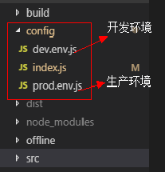
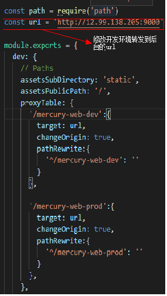
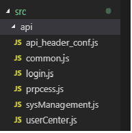
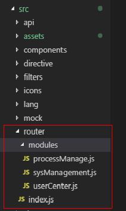
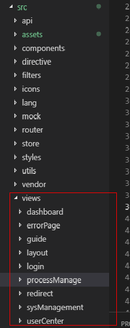
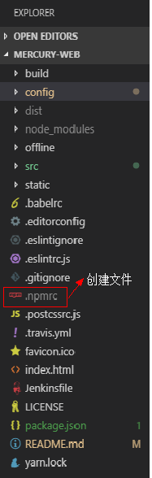
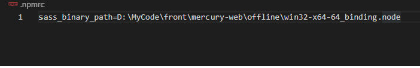
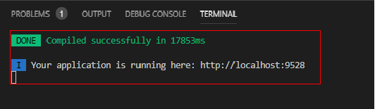

## 内管系统前端工程
----

### 项目介绍

```
内管系统前端模板：
内管系统前端模板，主要包括，“首页”，“引导页”，“流程审批”，“系统管理”，“用户设置”等模块
```

----
### 工程结构 <主要项> ###

**目录**

* 1.config下为系统环境的相关配置：dev.env.js为开发环境，prod.env.js为生产环境，index.js为开发环境中配置的后台转发地址，

  请根据实际地址自行配置；


  


  


* 2.src下api为各模块调用的api接口


   


* 3.src下router路由配置，其中index.js为主路由


  


* 4.src下viwes各个模块的页面  

  
      


----
### 技术选型 ###

**node.js**

**Element UI**


----
### 使用说明 ###

**初始化项目**

* 1.优先安装node.js,Element UI依赖于node.js;

* 2.安装开发工具，我们强烈建议您使用VSCode;

* 3.在根目录下创建.npmrc文件，填写本地node-sass的路径<该路径为node-sass对应版离线本地路径>
    sass_binary_path=C:\Your own path\manager\offline\linux-x64-57_binding.node;

  


  


  《说明》：关于路径问题，请在本地磁盘项目存放路劲中找到：..\mercury-imbase-web-m\offline\win32-x64-64_binding.node


* 4.使用公开 npm 源安装依赖：npm install


* 5.使用命令 npm run dev 运行项目;


* 6.项目启动成功后的界面;





      

----


**项目打包**


```
使用命令：

    dev打包：yarn run build:dev
    prod打包：yarn run build:prod

```
----

### 注意事项
#### 请不要提交修改后的.npmrc 文件


